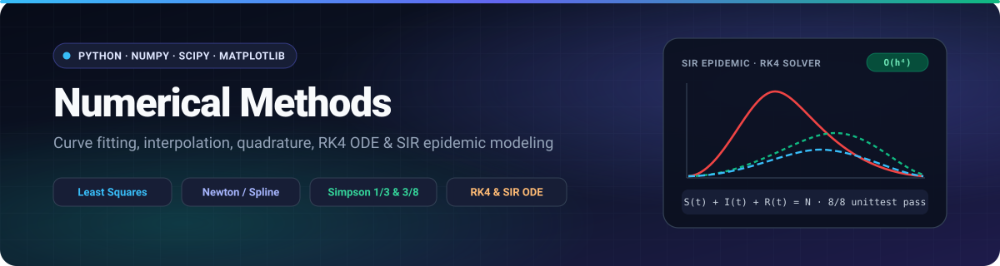
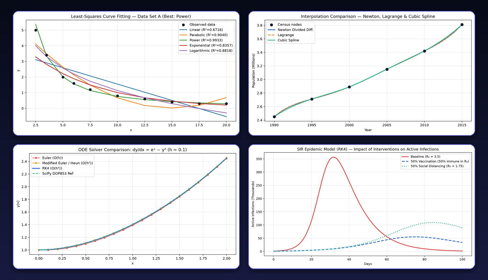
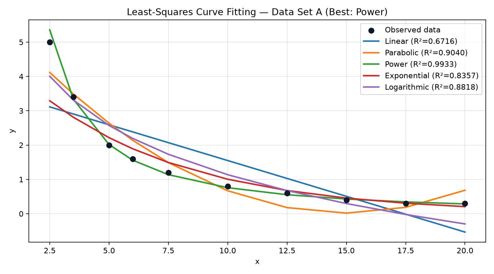
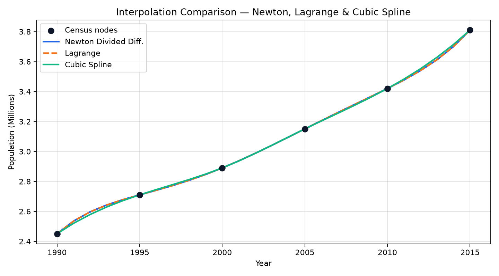
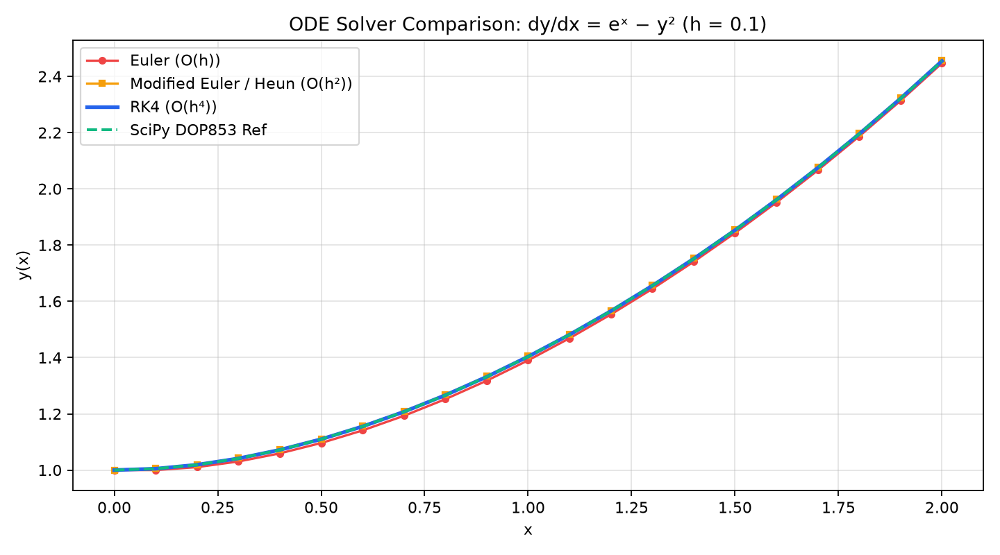
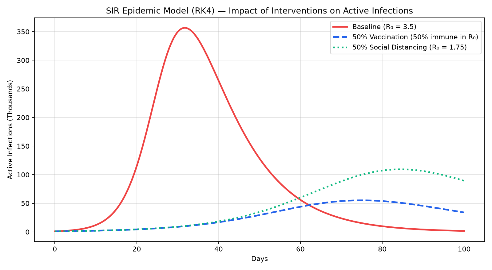

<div align="center">



<br /><br />

[](https://www.python.org/)
[](https://numpy.org/)
[](https://scipy.org/)
[](tests/test_numerical_methods.py)
[](LICENSE)

**A modular, verified Python toolkit implementing core numerical analysis algorithms from scratch — curve fitting, polynomial & spline interpolation, finite-difference differentiation & Simpson quadrature, RK4 ODE solvers, and a mass-conserving SIR epidemic simulation.**

[Modules](#modules) · [Generated Plots](#visual-results) · [Benchmarks](#verified-numerical-results) · [Quick Start](#quick-start) · [Testing](#testing)

</div>

---

<p align="center">
  
</p>

## Modules

| Directory | Script | Methods Implemented | Validation & Extras |
| :--- | :--- | :--- | :--- |
| `01_curve_fitting/` | `least_squares.py` | Linear, Parabolic, Power, Exponential, and Logarithmic Least-Squares + SSE & $R^2$ | Positive domain checks (`x > 0`, `y > 0`), constant-$y$ guard, `--save-plot` |
| `02_interpolation/` | `interpolation.py` | Newton Divided Differences, Lagrange Polynomial, Cubic Spline + scaling study | Strict distinct-node & array-shape checks, `--save-plot` |
| `03_differentiation_integration/` | `diff_and_integration.py` | Newton Forward/Backward derivatives, Lagrange derivative, Trapezoidal, Simpson's 1/3 & 3/8 | Positive step-size & subinterval parity/divisibility guards |
| `04_ode_solvers/` | `ode_comparison.py` | Explicit Euler, Modified Euler (Heun's), and classical 4th-order Runge-Kutta (RK4) | Max absolute error benchmark against SciPy `DOP853` (`rtol=1e-12`), `--save-plot` |
| `04_ode_solvers/` | `sir_epidemic_model.py` | Coupled SIR epidemic ODE system solved with RK4 (Baseline, 50% Vaccination, 50% Distancing) | Enforces exact mass conservation $S(t) + I(t) + R(t) = N$, `--save-plot` |

---

## Visual Results

All plots below are generated directly by the toolkit's scripts (`--no-plot --save-plot`):

<table>
  <tr>
    <td width="50%">
      
      <p align="center"><strong>Curve Fitting (Data Set A)</strong><br />Power model achieves best fit ($R^2 = 0.9933$, $\text{SSE} = 0.1454$).</p>
    </td>
    <td width="50%">
      
      <p align="center"><strong>Population Interpolation</strong><br />Newton, Lagrange, and Cubic Spline across 1990–2015 census nodes.</p>
    </td>
  </tr>
  <tr>
    <td width="50%">
      
      <p align="center"><strong>ODE Accuracy Comparison</strong><br />$y' = e^x - y^2$ solved with $h = 0.1$ vs SciPy <code>DOP853</code> reference.</p>
    </td>
    <td width="50%">
      
      <p align="center"><strong>SIR Epidemic Simulation ($N = 10^6$)</strong><br />Flattening active infections via vaccination ($R_0$ immune) &amp; distancing.</p>
    </td>
  </tr>
</table>

---

## Verified Numerical Results

### ODE Solver Max Absolute Error ($dy/dx = e^x - y^2$, $y(0) = 1$, $h = 0.1$, $x \in [0, 2]$)

| Solver | Order | Max $|y - y_{\text{ref}}|$ vs `DOP853` |
| :--- | :---: | :---: |
| Explicit Euler | $O(h)$ | `1.430545e-02` |
| Modified Euler (Heun's) | $O(h^2)$ | `2.145841e-03` |
| **Classical Runge-Kutta (RK4)** | **$O(h^4)$** | **`1.877807e-05`** |

### SIR Epidemic Interventions ($N = 1{,}000{,}000$, $\beta = 0.35$, $\gamma = 0.10$, 100 days)

| Scenario | Initial Compartments $(S_0, I_0, R_0)$ | Peak Active Infections | Peak Day | Cumulative Infected |
| :--- | :--- | :---: | :---: | :---: |
| **Baseline ($R_0 = 3.5$)** | `(999,000, 1,000, 0)` | `356,634` | `31.8` | `965,793` |
| **50% Vaccination** | `(499,500, 1,000, 499,500)` | `55,181` | `74.9` | `311,257` |
| **50% Social Distancing ($R_0 = 1.75$)** | `(999,000, 1,000, 0)` | `109,363` | `84.5` | `567,061` |

---

## Quick Start

```bash
git clone https://github.com/Alizhan-T/numerical-methods-python.git
cd numerical-methods-python
python3 -m venv .venv
source .venv/bin/activate
pip install -r requirements.txt
```

Run any module (pass `--no-plot` for headless CLI output or `--save-plot out.png` to export figures):

```bash
python3 01_curve_fitting/least_squares.py --no-plot
python3 02_interpolation/interpolation.py --no-plot
python3 03_differentiation_integration/diff_and_integration.py
python3 04_ode_solvers/ode_comparison.py --no-plot
python3 04_ode_solvers/sir_epidemic_model.py --no-plot
```

---

## Testing

Run the automated `unittest` suite covering all 4 modules:

```bash
python3 -m unittest discover -s tests -v
```

Verifies **8 automated test specs**:
- Exact least-squares linear/parabolic fits, constant-$y$ $R^2$ guard, and log-domain `ValueError` checks
- Newton & Lagrange polynomial exactness on degree-3 polynomials + duplicate-node rejection
- Quadrature convergence on $\int_0^\pi \sin(x)\,dx = 2$, exact quadratic Lagrange derivative, and step/subinterval validation
- Strict ODE error hierarchy ($\text{RK4} < \text{Heun} < \text{Euler}$) vs SciPy `DOP853`
- Exact SIR total population conservation $S(t) + I(t) + R(t) = N$ and unbalanced-initial-condition rejection

---

## License & Author

Released under the [MIT License](LICENSE).  
Built by **[Alizhan Toleukhan](https://alizhan-t.github.io/)** ([`@Alizhan-T`](https://github.com/Alizhan-T)).
